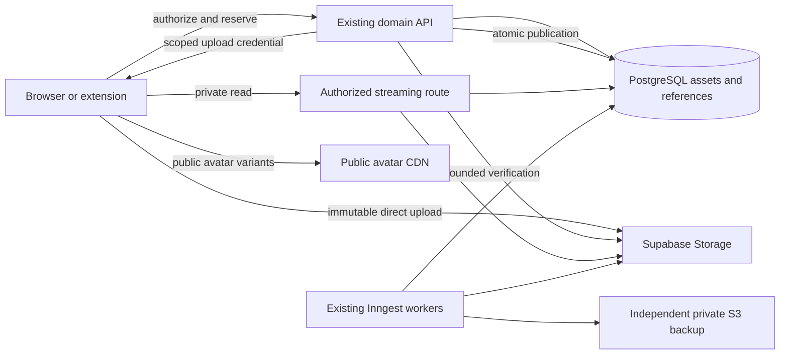

# Application storage redesign and implementation plan

Date: 30 September 2026  
Status: replacement implementation plan; application changes and deployment have not been performed by this review.  
Repository: `/Users/chrama/Downloads/nb-s3`  
Live database inspected: Supabase `iutauehhgdymtpzrnzcy`, Singapore.  
Method: Ponytail Full/Audit principles, repository workflow, source tracing, read-only catalog/data queries, and focused regression checks.

## 1. Decision and limits of the conclusion

The previous plan covered the principal storage journeys, but it was **not complete enough to implement safely**. This review adds direct database mutation controls, missing version repair, contribution-trigger semantics, hot-project contention, deletion-safe foreign keys, obsolete operational scripts, migration governance failures, and an explicit application-wide capacity gate.

Keep Supabase Storage as the initial object store. Replace the fragmented upload, publication, authorization, and deletion contracts with one small asset lifecycle, used by the existing application domains. Keep PostgreSQL, Inngest, Supabase clients, Sharp, fflate, native streams, and the current domain boundaries. Compare an AWS S3/CloudFront implementation using the same workload before considering a separate provider migration.

One million registered users is the agreed population target. It does not describe concurrent traffic or prove performance. The release must meet the workload and measurable gates in section 8. “Without degradation” means the defined peak remains within the latency, correctness, availability, and resource budgets; it is not an unlimited-load guarantee.

The inventory covers every discovered source folder and SQL file. It distinguishes automated scanning from manual review. This report does **not** claim that every line of every component has been manually proved correct, that every production configuration is known, or that load and recovery tests have already passed. Those are explicit completion gates, not implied results.

### Artifacts that are part of this plan

- [Folder, SQL-file, and direct-storage coverage](../../audits/2026-09-30-storage-plan-validation/coverage.md).
- [Machine-readable file hashes and matching line numbers](../../audits/2026-09-30-storage-plan-validation/inventory.json).
- [Reproducible evidence, source anchors and check results](../../audits/2026-09-30-storage-plan-validation/evidence.md).
- [Concurrent-change inventory and review cutoff](../../audits/2026-09-30-storage-plan-validation/concurrent-delta.json).
- [All 209 historical SQL/Supabase findings and their recorded dispositions](../../audits/2026-09-30-storage-plan-validation/historical-findings.md).
- [Original SQL/Supabase report](../../audits/complete-sql-supabase-audit-2026-08-13.md), including later implementation and Realtime activation records.
- [Files ecosystem report](../../audits/ponytail-files-ecosystem-2026-08-31.md), [GitHub sync report](../../audits/ponytail-github-sync-2026-09-01.md), and [messaging scale plan](../../plans/messages-1m-optimization-implementation-plan.md). Preserve their implemented behavior; revalidate their capacity and external acceptance claims.

These artifacts form one plan. A historical “done” entry does not override a current failing test, code path, or deployed catalog result. The inventory is a snapshot of a working tree containing unrelated changes; each implementation phase must refresh affected hashes and preserve those changes.

## 2. Current evidence

### Repository and checks

| Evidence | Result | Interpretation |
|---|---|---|
| Initial source inventory | 996 files, including styles, fonts, licenses, and one hidden source file | Text scanned; binary assets fingerprinted; later additions are in the concurrent-change inventory |
| Initial SQL inventory | 174 SQL files, 58,072 lines | Includes immutable seed history; later migration0177 is in the concurrent-change inventory |
| Route/page inventory | 117 route/page files | Actions, hooks, workers, and scripts are additional entry points |
| Source query discovery | 260 files match the documented query patterns | Heuristic discovery, not an AST-derived count of distinct SQL statements |
| Direct storage API discovery | 41 source files match storage API patterns | Indirect image/render consumers are included in the component matrix below |
| Current focused baseline | 37 tests passed; zero failed/skipped | Security, attachments, purge, SQL remediation, and native client contracts; several are source-contract tests |
| Migration journal check | Passed using `node --import tsx` | Local journal validity alone does not establish deployment parity |
| SQL governance check | Failed | Initial 0176 mismatch; final rerun also flags concurrent `0177_projects_member_file_upload_default`; journal has 175 entries and manifest 173 |
| Runtime role checker | Did not execute its SQL | Top-level await was compiled as CommonJS; fix the checker entry point and rerun against the actual runtime connection |
| Standard `tsx` script launcher | IPC socket denied by sandbox | Journal/governance were rerun using Node's import loader; this is separate from the governance assertion failure |

The focused command was:

```sh
node --import tsx --test \
  tests/unit/upload-security.test.ts \
  tests/unit/attachment-pipeline-optimization.test.ts \
  tests/unit/files-tab/permanent-delete-safety.test.ts \
  tests/unit/sql-supabase-runtime-remediation.test.ts \
  tests/unit/sql-query-remediation-contract.test.ts
```

Earlier overlapping test runs are not added to the 37-test count. Full build, browser validation, disposable SQL replay, production load, and restore drills were not run in this review.

### Concurrent changes incorporated before handoff

The shared repository advanced during this review. The base inventory is retained rather than silently replacing its evidence. The linked delta captures changed/new file hashes and the final review cutoff: 999 source files, excluding an editor temporary file, and 175 SQL files / 58,075 lines. The relevant changes were inspected and incorporated:

- Project creation now has a project-picture input and calls the new shared `src/lib/upload/project-image-upload-client.ts` after creating the project. Reuse this shared owner in P04/P06/P08. Preserve its truthful partial-success warning. The in-memory File is not a durable resumed draft: after reload require explicit reselection, or resume only a verified server-side asset; do not imply that saved form JSON preserves image bytes.
- Creation now persists public-tab visibility, member update/upload defaults, document editing policy and notification groups. Cover/file authorization and upload completion must honor these settings from the first render. Validate start and publish against the effective per-member upload permission. The default affects newly joined members; changing it must not silently rewrite existing members' overrides.
- Concurrent migration0177 adds `projects.member_file_upload_default`; application reads/writes now expect it. Include it in replay/catalog/deployment-order verification and the governance repair. This review did not verify its deployment to the connected database.
- `PersonCardGrid` now retains appended card DOM with `content-visibility`, replacing prior virtualization. This can reduce paint work but does not bound retained DOM, decoded images or query data. F65 adds an explicit long-list memory/interaction qualification and a bounded rendering remedy.
- Layout and wizard navigation/skeleton changes remain regression targets in T11/T16/T19/T32. This is a focused review of the storage-relevant delta, not a claim of complete manual review of every concurrent layout change.

### Live database and storage

Read-only queries found 95 public tables, 148 public policies, 15 storage policies, and no public table with RLS disabled. The database is approximately 145 MB. That small current dataset is not representative of 50 million references.

| Bucket | Public | Live file limit | Required disposition |
|---|---:|---:|---|
| `avatars` | Yes | 10 MiB | Keep only published public derivatives here; align direct-write privileges and the 2 MiB source-image contract |
| `chat-attachments` | No | 50 MiB | Keep; verified attachment ownership and authenticated reads |
| `project-files` | No | 10 MiB | Keep; project content, covers and explicit internal purposes with domain authorization |
| `project-updates-media` | **Yes** | 8 MiB | Move to private delivery; visibility must follow the owning update and project |
| `extension-recovery-drafts` | No | 10 MiB | Keep; repair lifecycle controls and retain bounded recovery behavior |
| `task-files` | No | 10 MiB | Legacy read/migration only; retire after complete reference reconciliation |

There is no `exports` bucket in this inventory. Project covers currently use `project-files` with legacy cover references in `avatars`; `project-covers` is a key prefix, not an additional live bucket.

**Version integrity:** 9,774 active nodes have non-null storage keys. Of those, **5,859 have no version row at all**, and therefore no row matching `current_version`. This count does not establish whether each object exists or who authored it. Repair requires object and provenance verification; do not fabricate content or credit the migration operator.

**Permissions:** client grants on several lifecycle/content tables include broad DML and other privileges. RLS remains enabled. The concrete problem is that own-row policies on upload intents allow lifecycle fields to be written without the application verifier. Broad grants alone are not evidence that an anonymous caller can access arbitrary rows or invoke SQL TRUNCATE through the REST API.

**Advisors:** 195 unused-index notices are candidates for investigation, not a deletion list. Four overlapping permissive-policy warnings concern contribution/stage reads; one duplicate-index warning concerns `task_comments`. The security advisor reports 21 RLS-without-policy tables, many intentionally server-only, and leaked-password protection disabled. Document intentional fail-closed tables; never add permissive policies simply to silence a notice. See [unused index guidance](https://supabase.com/docs/guides/database/database-linter?lint=0005_unused_index), [policy guidance](https://supabase.com/docs/guides/database/database-linter?lint=0006_multiple_permissive_policies), [duplicate indexes](https://supabase.com/docs/guides/database/database-linter?lint=0009_duplicate_index), [RLS without policy](https://supabase.com/docs/guides/database/database-linter?lint=0008_rls_enabled_no_policy), and [password protection](https://supabase.com/docs/guides/auth/password-security#password-strength-and-leaked-password-protection).

## 3. Finding register: all current storage work

Severity: P0 = unauthorized access/deletion or data-integrity release blocker; P1 = correctness, recovery, or scale blocker; P2 = optimization/maintainability. Priority denotes implementation urgency, not a claim that an exploit was performed. Acceptance identifiers refer to section 10.

### Shared upload and asset lifecycle

| ID | Priority | Evidence/problem | Required solution | Phase / acceptance |
|---|---|---|---|---|
| F01 | P0 | `src/lib/upload/upload-intents.ts` upserts by bucket/key and can reset lifecycle state | Server-allocated immutable keys; no upsert; stable idempotency identity, immutable purpose/scope | P03 / T01,T02 |
| F02 | P0 | Finalize-by-ID does not bind every supplied bucket/key; batch lookup omits bucket | Resolve by opaque asset ID and bind owner, purpose, target, bucket, key, size, MIME, expected revision | P03 / T01 |
| F03 | P1 | Verification and domain publication are separate, leaving unattached objects | Verified assets may be pending attachment; attach and domain write commit atomically; expire abandoned verified assets | P03 / T02,T03 |
| F04 | P1 | A requested 32-byte Range can receive HTTP 200 and buffer the full object; no effective byte/time bound | Bounded streams, status/length validation, cancellation; full streamed checksum where required | P03 / T04 |
| F05 | P1 | Transient object-info failures become permanent intent failure | Classify retryable/terminal errors; leased verification with bounded attempts and persisted outcome | P03 / T03 |
| F06 | P1 | Whole-file XHR retries lack adequate timeout/cancellation controls; concurrency overrides unbounded | One transfer queue, absolute/idle deadlines, abortable backoff and bounded TUS | P04 / T05 |
| F07 | P1 | Size/MIME limits and aggregate quota decisions differ between client, route and bucket | One purpose contract compiled into validators and checked against live bucket configuration | P02,P03 / T06 |
| F08 | P0 | Cleanup eligibility/reference checks race with attachment and reusable credentials | Serialize attach/delete through asset rows; stop new attachment before removal; retain reservation until credential risk ends | P03,P09 / T07 |

### Chat

| ID | Priority | Evidence/problem | Required solution | Phase / acceptance |
|---|---|---|---|---|
| F09 | P0 | Attachment presign lacks complete conversation membership validation and can reset sessions | Authorize conversation at initiation and commit; idempotency cannot reopen committed uploads | P05 / T08 |
| F10 | P0 | Finalize accepts replacement keys under an owner prefix without full object/lifecycle verification | Only attach the server-issued verified asset; reject scope/key/expiry/state mismatch | P05 / T01,T08 |
| F11 | P1 | Prefix hash/CAS metadata is treated as content identity | Verify SHA-256 over all bytes; do not infer digest from path or trust a client claim | P03,P05 / T04 |
| F12 | P1 | Fallback is not awaited/returned; server-action size limit conflicts with 50 MiB; retry IDs/returned route IDs diverge | Remove the duplicate byte-upload fallback; one direct transfer and one durable finalize outcome | P04,P05 / T05,T08 |
| F13 | P1 | Existing attachment route redirects to a 24-hour signed URL despite domain checks | Authenticated no-store stream; preserve hidden/deleted/block/membership checks and Range | P05 / T09,T10 |
| F14 | P2 | Fake progress/no abort; thumbnails may request originals; video download filename path is inconsistent | Separate transfer/verification/publication progress; genuine cancellation; real variants and safe disposition | P04,P05 / T05,T11 |
| F15 | P1 | Retention repeatedly selects already-cleaned rows and does not consistently guard every shared reference | Durable eligible rows, indexed references, bounded claim batches and measurable backlog | P09 / T07,T17 |

### Profiles, person cards, covers, updates

| ID | Priority | Evidence/problem | Required solution | Phase / acceptance |
|---|---|---|---|---|
| F16 | P1 | Avatar verification and profile save separate; cleanup/enqueue and replacement races; preview URLs leak | Atomic attach to profile; durable cleanup of superseded assets after rereference guard; revoke object URLs | P06 / T02,T11 |
| F17 | P1 | Avatar bucket allows 10 MiB while app source cap is 2 MiB; write paths and rate limits diverge | Private staging, explicit 2 MiB/16 MP validation, final public variants and per-purpose throttles | P02,P06 / T06,T11 |
| F18 | P0 | Cover route caches a short-lived redirect for up to one year; cleanup removes all siblings except one | Private authorized streaming, content revision identity, reference-based deletion | P06 / T09,T12 |
| F19 | P0 | Public update bucket bypasses owning update visibility; media read lacks complete reference/deletion checks | Private bucket and normalized update-media attachment rows; authorize update and project per read | P02,P06 / T09,T13 |
| F20 | P1 | Abandoned update media and event-supplied cleanup keys escape ownership checks | Asset lifecycle for drafts and attached media; worker resolves IDs from DB, never trusts arbitrary event keys | P06,P09 / T07,T13 |
| F21 | P2 | ProjectAvatar/original-image paths and Next image caching defeat byte/revocation budgets | Shared responsive public avatar variants; private images bypass shared Next image cache | P06 / T09,T11 |

### Files, tasks, documents, versions and exports

| ID | Priority | Evidence/problem | Required solution | Phase / acceptance |
|---|---|---|---|---|
| F22 | P0 | Task-linked preview/extension paths omit some task/files-tab authorization | One domain read predicate covering project state, tab, task, link, node, version and user | P05,P07 / T09,T14 |
| F23 | P1 | Version-only ETag does not change for active-revision byte changes | Asset ID/content revision is response identity; auth precedes conditional evaluation | P05,P07 / T10 |
| F24 | P0 | Client/server compensating deletion can remove a successfully committed upload after response loss | Query idempotent operation result; cleanup only through asset lifecycle | P03,P07 / T02,T07 |
| F25 | P1 | Some old-object cleanup checks only versions, omitting nodes, Trash or sync pins | Indexed references across all owners; block attachment once deleting | P07,P09 / T07 |
| F26 | P1 | PDF/inline readers buffer full content, lack abort; Git fallback can use wrong revision/unbounded body | Range streaming, byte caps before allocation, immutable Git SHA, exact error states | P05,P07 / T04,T10,T15 |
| F27 | P1 | Signed URLs expire during open views; client cache has independent expiry/account identity | Stable authenticated routes; bounded viewer-scoped query keys and logout clearing | P05,P07 / T09,T16 |
| F28 | P1 | Version cleanup considers only latest 100; task uploads have a separate queue and pretend progress | Cursor-page all retained refs; shared transfer queue and canonical revision publication | P07,P09 / T05,T07 |
| F29 | P1 | Relative document images work through GitHub paths but not all uploaded projects | Resolve normalized local node paths inside the project; enforce task/project access; pin Git fallback SHA | P07 / T15 |
| F30 | P1 | ZIP export buffers the archive, signs all files, and emits failure text as apparent success; key-to-node map collapses copies | Bounded manifest and reference pins; stream archive, preserve each logical path, abort on missing bytes | P07 / T18 |
| F31 | P1 | Account export allocates full history and redundantly uploads JSON to missing `exports` bucket | Cursor-based authenticated streaming export; remove unused upload; clear partial-export failure semantics | P07 / T18 |

### Project creation, imports, GitHub, extension

| ID | Priority | Evidence/problem | Required solution | Phase / acceptance |
|---|---|---|---|---|
| F32 | P1 | Bulk folder creation exposes file placeholders before publication; successful worker upload lacks canonical finalize | Stage manifest; publish only verified nodes/version rows; folders use valid parent/path invariants | P08 / T19 |
| F33 | P1 | All URLs signed up front; upload notification precedes publication; browser task described as background-safe | Rolling signing window, durable server operation where applicable, accurate stage/partial results | P04,P08 / T05,T19 |
| F34 | P0 | Mirror operation can act on incomplete manifest; huge transactions and session read/write races | Explicit completed manifest, generation CAS, bounded per-file checkpoints; no destructive mirror from partial input | P08 / T19,T20 |
| F35 | P1 | Git import has 25 MiB expectation vs 10 MiB bucket; `imports/job` keys disagree with parser | Shared 10 MiB contract, service-issued assets, no guessed path authorization | P08 / T06,T19 |
| F36 | P0 | Import abort can delete published objects; finalize retry checks pending before completed; counters race | Durable operation identities, monotonic transitions, atomic counts, detach through reference owner only | P08 / T02,T20 |
| F37 | P1 | Manifest count/path/byte and tarball expansion/queue limits are incomplete | Bound entries, compressed/uncompressed bytes, path depth/length, duplicates and queue depth; reject links and traversal | P08 / T04,T19 |
| F38 | P1 | Hydration catches errors with no retry and can mark ready; stale detection uses project.updatedAt | Operation lease/heartbeat, fenced worker, explicit partial/failed status, retry classification | P08 / T20 |
| F39 | P0 | Extension accepts raw storage key/hash, then privileged cleanup can delete that key after revision error | Remove arbitrary-key delete; asset ID + verified upload + revision lease + operation status | P07 / T01,T02,T14 |
| F40 | P1 | Extension bulk metadata/revision bindings and force-inline limit have gaps | Bound batch to 50; exact per-file target/revision; 512 KiB inline cap enforced regardless of flags | P07 / T06,T14 |
| F41 | P1 | Recovery draft reads/finalized state and fire-and-forget pruning inconsistent | Durable draft transitions, expiry checks, 10 MiB/three generations/30-day retention; owner-safe reads | P07,P09 / T14,T17 |
| F42 | P1 | Sync snapshots and retained operation objects are live references outside ordinary nodes | Explicit pins, verified immutable content, bounded cleanup only after terminal operation and retention | P08,P09 / T07,T20 |

### Maintenance, SQL and operations

| ID | Priority | Evidence/problem | Required solution | Phase / acceptance |
|---|---|---|---|---|
| F43 | P0 | Project deletion drops database evidence before all versions, covers, media and imports are addressed | Tombstone and durable detach work before cascading rows; object lifecycle survives owner deletion | P02,P09 / T07,T21 |
| F44 | P1 | Recursive cleanup/list pagination, legacy copy/delete, and account loops have incomplete bounds/verification | Keyset workers; validate destination hash/size before swap; never remove pre-existing target on retry | P09 / T17,T21 |
| F45 | P1 | Permanent deletion holds DB transactions during storage I/O; pool is only ten connections per process | Claim/commit, perform I/O, fenced completion transaction; no network calls under row locks | P03,P09 / T07,T22 |
| F46 | P1 | Cleanup100/hour, reconciliation200/6h, legacy50/day and hard-delete100/day cannot establish target recovery throughput | Size workers from arrival rates, backlog age and outage catch-up; fair per-tenant limits and persisted cursors | P09,P11 / T17,T23 |
| F47 | P1 | Reconciliation skips incomplete references, advances cursor after unresolved failures, and may attach by path guess | Retry ledger separate from scan cursor; all reference families; quarantine ambiguous matches | P09 / T17,T21 |
| F48 | P1 | CDN purge stub reports success; metric logging can be suppressed or stripped in production | Remove fake success; measurable provider outcome; production-safe metrics sink and finite labels | P10 / T24 |
| F49 | P1 | Database backups omit object bytes | Independent S3 object backup, consistent manifests, deletion journal and full restore drill | P10 / T25 |
| F50 | P1 | CSP/media/frame restrictions and redirected storage URLs conflict with PDF/video rendering | Serve same-origin private streams; exact CSP for required media/blob workers and scoped external images | P05,P06 / T10,T11 |
| F51 | P0 | Browser wizard draft keys are not consistently account scoped | Namespace draft/cache state by user and operation, clear on logout, reject foreign resume | P04,P08 / T16 |
| F52 | P0 | Live own-row upload-intent policies allow direct insert/update of verification metadata/state | Revoke direct lifecycle DML; allow only narrow authenticated application operations; adversarial Data API tests | P02 / T26 |
| F53 | P0 | Live node/version writes bypass revision/quota/deletion owners; read policies omit parts of task/tab/project state | Align SQL and application predicates; revoke raw lifecycle writes; preserve necessary authorized reads | P02 / T26,T27 |
| F54 | P1 | `file_versions.s3_key` has no supporting index; node key index excludes Trash | Transitional non-null key indexes including Trash; indexed asset foreign keys in final schema | P02 / T28 |
| F55 | P1 | Contribution trigger interprets NULL→hash backfill as content contribution and increments project sequence | Explicit trusted maintenance path with no semantic event; preserve actual revision attribution | P02,P09 / T29 |
| F56 | P1 | Contribution writes update the project row, serializing unrelated files in a hot project | Keep transactions short; separate ordered event counter; batch sequence allocation; benchmark remaining ordered-write ceiling | P02,P11 / T22,T29 |
| F57 | P0 | Cascading owner/project FKs can erase upload/import/recovery cleanup evidence | Independent asset tombstones and operation records survive hard deletion; tested reference/FK lifecycle | P02,P09 / T21 |
| F58 | P1 | 5,859 stored active nodes have no version; migration0069 was a one-off backfill | Verified backfill with immutable provenance; new publication always creates valid initial version | P02,P09 / T27,T29 |
| F59 | P1 | Legacy task-file CLI targets absent `task_files`, omits required path/version, copies with upsert before lock | Retire obsolete CLI after environment inventory; one resumable manifest migration path for remaining objects | P01,P09 / T21,T30 |
| F60 | P1 | Hash backfill buffers, updates by ID without original key comparison, triggers contributions, exits success after partial failures | Stream hash; CAS key/revision; durable checkpoints and nonzero partial-failure status; silent trusted maintenance | P09 / T04,T29,T30 |
| F61 | P1 | Local governance mismatch and runtime-role checker launch failure prevent trustworthy release evidence | Repair current migration manifest with owning change; ESM-safe checker; actual runtime-role and fresh replay gates | P01,P02 / T31 |
| F62 | P1 | Live overlapping contribution policies and disabled native password protection remain despite historical remediation | Reconcile live policy OR semantics; enable configured native protection and verify supported Auth behavior | P02,P10 / T26,T31 |
| F63 | P2 | Duplicate task-comment index and many “unused” indexes | Remove only proven redundant index after definition/constraint/workload comparison; retain rare maintenance indexes | P02,P11 / T28 |
| F64 | P1 | Storage-only throughput would miss Auth, SQL, Realtime, page rendering, search and notification contention | Whole-application mixed-load and hot-tenant qualification; one measured capacity report | P11 / T23,T32 |
| F65 | P1 | Concurrent `PersonCardGrid` change appends all visited rows; content-visibility does not bound retained DOM/image/query memory | Test long lists; retain at most a bounded visible window using the already installed Virtuoso where needed; preserve variable-height cards and scroll restoration | P06,P11 / T11,T33 |

## 4. Component, input, output and SQL coverage

The table is the required end-to-end test map. It includes indirect consumers that never call Storage themselves. Every discovered route/action/worker belongs to a row; phase P01 makes that assignment explicit in the inventory. An unassigned entry blocks completion.

| Component / owners | Inputs and authorization | SQL and durable state | Outputs / storage behavior |
|---|---|---|---|
| Shared upload (`src/lib/upload`, `src/app/actions/upload.ts`) | Purpose, target ID, name, size, MIME, idempotency key; authenticated scope | Asset reservation, quota, operation identity | Scoped direct-upload credential; verified asset ID, never arbitrary storage authority |
| Chat composer and `messages/attachments` API | Conversation, membership, attachment selection, message client ID | Attachment session, message, normalized attachments, block/hidden/deletion state | Progress, committed descriptors, authorized image/video/document/download stream |
| Chat list/thread/replies/search/forwarding | Viewer and authorized conversation/message | Canonical preview/read/reaction queries | Only visible attachment metadata; lazy thumbnail; explicit handling of shared copies |
| Own profile and edit modal (`actions/profile.ts`) | Owner identity, validated source image, profile revision | Profile reference and asset publication transaction | New avatar/banners; public avatar variants only after verification |
| Other profiles, person cards, discover, connections, mentions | Viewer-sensitive profile projection | Shared narrow profile read; contribution visibility | Shared avatar renderer, alt text, stable dimensions, fallback, no per-card signing/Presence |
| Project create wizard, draft/resume, folder upload | Project draft, complete manifest, files, user-scoped local state | Draft/import operation, membership, nodes, initial versions | Accurate uploaded/verified/published counts; resumable stages; no empty published file |
| Project cards, hub, workspace, profile project grid | Public/member project visibility and state | Narrow project/cover/owner projection; bounded pagination | Authorized cover URL and correctly sized image; no original per card |
| Project details/settings/team/invites | Role, project revision, cover and settings changes | Project/member/tab predicates, versioned cover ref | Consistent public/private rendering; membership changes revoke future reads |
| Project updates, drafts/comments/notifications | Author/member and owning update visibility | Update/media child rows, soft deletion, notification recipients | Same authorized media across feed, detail and notifications; no public-bucket bypass |
| File tree, folder list, quick open, search, recent/starred | Project/task/files-tab permissions, cursor/search/filter | Indexed nodes, paths, aliases and links; no full-tree bootstrap | Bounded pages with IDs and metadata, no eager signing of every file |
| File viewer/editor/history/diff/download | Node + immutable revision, role/lease, Range | Current revision/version rows, optimistic concurrency, retained history | Byte-exact stream/conditional result; explicit missing-content state |
| Tasks, deliverables, comments, linked-work picker, sprints | Task visibility and project membership | Task-node links, same-project checks, tags, versions | Authorized file descriptors even when Files tab differs from task access |
| Project docs and relative images | Slug, node path, viewer, Git revision where applicable | Project/doc/tab/node references | Sanitized markdown and authorized local media; SHA-pinned remote fallback |
| ZIP/folder export | Authorized bounded selection and output mode | Snapshot manifest and expiring pins | Backpressured ZIP; every logical copy/path retained; error terminates stream |
| Account export/deletion/settings/sessions | Current identity and required reauthentication | Cursor reads, deletion request, durable tombstone; no sensitive token export | Streamed export; blocked future writes/read access after deletion |
| GitHub import/preflight/tarball/hydration | Authorized repository/ref, path manifest and budgets | Import job/file transitions, leases, per-file publication | Exact SHA content, explicit partial outcomes, retryable progress |
| Reviewed GitHub sync and webhooks | Existing review/identity/remote authorization; signed webhook | Run/baseline/checkpoints/snapshot pins and contribution provenance | Preserve native Git, immutable snapshots, remote identity recovery and reviewed publication |
| Extension file/bulk/recovery APIs | Scoped token/session, asset ID, node revision/lease | Same revision owner plus recovery draft/session rows | Bounded inline content or authorized stream capability; compatibility response envelope |
| Reconciliation/retention/key migration workers | Claimed DB operation; no client key trust | Indexed refs, durable cursor/retry ledger, fenced lease | Idempotent delete/copy/repair; retryable missing/provider failures |
| Auth/onboarding/MFA/roles/privacy | Existing Auth/role authority and validated input | Auth/profile lineage, permission rows, fail-closed RLS | No session-bearing cache leakage; cache reset and prompt revocation |
| Search, discovery, social graph, role applications | Authorized, bounded filters/cursors | Set-based queries, selected fields and stable pagination | Only permitted profiles/projects/media; one avatar path across UI |
| Notifications, workspace counters, contributions | Committed domain event identity | Durable idempotent delivery, batched preferences, canonical counters | No premature upload success, no raw private URL/token in payloads |
| Realtime and Presence | Native Auth session, private scoped rooms | Publication/policy inventory, authoritative DB reconciliation | Invalidation only where designed; bounded rooms; no channel per asset |
| Deployment, backup, scripts and SQL governance | Reviewed environment and least-privilege credentials | Append-only migrations, catalog parity, backup manifests | Reproducible deploy/restore, observable failure and documented ceiling |
| Static pages, design assets, styles, fonts, legal pages | Static content; no user upload authority | Usually no storage SQL; verify indirect avatar/layout use | Preserve caching/accessibility and bundle behavior; no unnecessary storage rewrite |

For each endpoint record input schema, role, ownership predicate, SQL owner, row/byte limits, transaction scope, storage operation, output schema/status, cache headers, idempotency behavior, and error cleanup. Include server actions, browser RLS calls, service-role code, CLI scripts, worker retries and PostgREST/RPC access. Testing only the visible UI leaves bypasses.

## 5. Target architecture

### 5.1 Native ownership and minimal additions



Add an asset table and narrow helpers, not a generic repository, event bus, media microservice, provider framework, or another queue. Domain-specific access remains in existing files/chat/profile/update owners. Add `tus-js-client` only as a lazy transfer dependency for resumable files; do not add Uppy or an AWS SDK to the browser. Operational backup tooling is isolated from the application bundle.

### 5.2 Asset identity and references

Use a server-generated `assetId`, unique `(bucket, key)`, purpose, scope IDs, source/derived relationship, declared and verified bytes, detected MIME, full digest when verified, creation/expiry/deletion timestamps, verification lease/fence, idempotency identity and last classified error. Keys are immutable and unrelated to user-controlled paths. Do not deduplicate across tenants; same bytes do not imply interchangeable authorization or retention.

Persistent states: `pending`, `verified`, `delete_pending`, `deleting`, `deleted`, `missing`. Verification progress is a lease, and attachment is established by real reference rows. This removes duplicate `verifying`/`attached` truth from the previous plan without losing their behavior. A rejected upload becomes non-publishable and eligible for safe cleanup with a classified error. A retry cannot revive a deleting/deleted asset. Verified assets without references expire after the publication grace period.

Add indexed asset IDs to existing domain references: profiles (avatar/banner), projects (cover), file versions/current content, message attachments, recovery drafts, and import/sync records. Normalize update-media entries into a child table. Keep direct domain FKs and authorization; do not use an unrestricted polymorphic `owner_type/owner_id` permission table. Snapshot/export pins are explicit, expiring references with a documented owner.

Use at most one quota counter row per user/project scope with atomic reservation. For a reference attach, lock the asset, confirm publishable state and scope, validate target permission/revision, attach, convert reservation to retained usage, and persist the operation result in one short transaction. For deletion, lock the same asset and block new references before storage removal. Reference checks must include Trash, old revisions, recovery, imports, snapshots, exports and both current/legacy references during migration.

### 5.3 Upload, verify, publish

1. Validate input and target permission; accept an idempotency key bound to the request fingerprint. Normalize filenames/paths without silently merging distinct entries.
2. Reserve quota and an outstanding-upload slot. Allocate a unique key and persist the operation before signing.
3. Issue a credential restricted to that object, with overwrite disabled. Browser writes cannot create other keys or set verification state through SQL/Storage policies.
4. Transfer bytes directly to Storage using the bounded shared queue. A timeout or response loss triggers status reconciliation, not blind new uploads.
5. Lease verification; inspect actual metadata and stream within byte/time limits. Validate actual bytes, MIME, size, relevant decoder limits and full SHA-256. Client hashes are hints until verified. An HTTP 200 response to Range must still obey the reader's cap; cancel immediately when the bound is exceeded.
6. Persist verification result with the lease fence. Retry transient failures; do not accept a partial hash as a full digest. Quarantine invalid content and report the actual failure.
7. Publish through the owning domain transaction. Recheck current authorization and target revision, create initial file version where applicable, record attribution only for actual content publication, and attach the asset.
8. Return the committed domain result. A lost response can be retried safely with the same operation ID. Post-commit notification is durable and idempotent.

No database lock is held across network transfer, object verification or image decoding. Upload completion is not publication completion. “Cancel” stops local transfer immediately, then records cancellation; the server reconciles credential lifetime and any already-committed publication.

### 5.4 Purpose and limit contract

MiB/GiB mean binary units. Preserve lower existing limits where applicable; a bucket maximum is not a permission to bypass a purpose maximum.

| Purpose | Limit and validation | Visibility / lifecycle |
|---|---|---|
| Profile avatar/banner source | 2 MiB; JPEG/PNG/WebP; 16 MP decode bound | Private staging; only verified public-avatar variants copied to public bucket; banner policy explicit |
| Project cover | 2 MiB; validated image | Project visibility/state, including legacy covers; no public-storage leak |
| Project file/task file/version | 10 MiB per file; canonical MIME/extension policy | Domain authorized; retained versions count toward quota |
| Chat attachment | 50 MiB; supported image/video/document types | Conversation/message membership, hidden/block/deletion rules |
| Update image | 8 MiB; validated image | Owning update and project visibility/deletion |
| Recovery draft | 10 MiB; text/JSON/binary according to existing contract | Owner/session; three generations, 30 days |
| Derived thumbnails/variants | Explicit per-parent variant list and total byte/pixel budget | Inherit private authorization or approved public-avatar status |
| Import manifests / sync snapshots | Service-only purpose; each child file stays within 10 MiB; manifest and operation bounds enforced | Pinned to authorized operation; terminal retention; never public signing input |
| Export archives / backup manifests | Service-only; streaming budgets and restore retention | Export authorization/pins; independent backup credentials |

Internal objects do not pass as generic project uploads. Separate limits for tiny manifests and any aggregate archive are explicit configuration with tests, not accidental exemptions from the 10 MiB bucket. Prefer DB manifest rows and stream archives; no larger bucket is added unless a retained aggregate object is actually required.

Empty text/code project files are valid with the hash of the empty body; empty images, PDFs and chat attachments are rejected. Integer, finite, nonnegative size validation is enforced on both client and server. MIME sniffing is not a malware-safety guarantee: arbitrary file downloads remain attachments with `nosniff`; HTML/SVG must never execute on the application origin. Keep unsupported executable/active-content types rejected and run all allowed previews in their safe renderer.

Quota: 1 GiB personal/chat and 10 GiB per project, including retained versions. Existing over-quota content remains readable; new reservations fail with actionable usage details. Within a scope, an immutable asset shared by multiple references is charged once; a copied asset in another scope is charged there. Temporary internal processing has a separate bounded operational budget. Reserve the enforced upper bound where the upload protocol cannot constrain declared length; adjust to verified bytes at commit. Keep outstanding reservations until upload credentials can no longer recreate content, including provider upload/session lifetimes and a margin.

### 5.5 Client transfer and rendering

- Four total transfers per tab, at most two TUS transfers; server batch at most 50, signing window 16, outstanding intents 64 per user. Server quota/rate controls apply across tabs/devices.
- Standard direct upload at or below 6 MiB; lazy TUS above 6 MiB with provider-compatible 6 MiB chunks. Three transient retries with jitter, abortable waits, 30-second idle deadline, ten-second control request deadline, 30-minute transfer attempt limit with resumable recovery.
- Expired credentials require authenticated renewal bound to the same operation and current permission. The storage session expiry still governs cleanup. Native resume keys are account/asset scoped; clear them after completion or logout.
- Folder selection: 5,000 files. Import/export manifest: 20,000 entries and 1 GiB operation bytes. Apply the existing smaller reviewed-sync limits: 500 compared paths, 10 MB/file, 64 MB workspace/operation, 30,000 metadata entries. Do not silently raise them to import limits.
- In-app editable source at most 10 MiB; ordinary inline text at most 2 MiB; extension inline at most 512 KiB regardless of force flags. Larger allowed content uses streams.
- Progress has distinct transfer, verification and publication stages; count committed files, surface partial failure, support retry/cancel, and never show false success. Browser-only work stops when its context closes; server work needs a durable operation.
- Reuse shared `UserAvatar`/project-image components. Public avatar variants: 64, 128, 400 pixels, responsive dimensions and lazy loading offscreen. Strip unnecessary metadata. Bound decoding in the existing worker; revoke preview object URLs.
- Private images use application routes and browser lifetime controls, not an indefinitely shared Next image optimizer cache. Reduce overfetch with stored derivatives; never download every original to draw a chat grid or person list.

Supabase recommends resumable uploads for files above 6 MB and its direct storage hostname for that path; signed upload tokens can authorize TUS. Keep overwrite disabled. [Supabase resumable uploads](https://supabase.com/docs/guides/storage/uploads/resumable-uploads)

### 5.6 Reads and revocation

All private read routes authorize the domain reference, not just a bucket prefix. Project public visibility does not automatically expose private tasks, hidden tabs, deleted updates or deleted nodes. Public avatars remain intentionally public.

Private responses stream through an authenticated route with `Cache-Control: private, no-store`, safe MIME/disposition, `nosniff`, cancellation, backpressure and supported single-range semantics. Authenticate before HEAD, 304, 206 and 416 handling. Validators reflect immutable asset/revision identity. Reject unsupported multipart-range amplification; do not buffer to synthesize it. Return a consistent domain error without exposing raw bucket keys, provider tokens or existence across scopes.

Do not expose an upstream signed download URL to private consumers. Supabase documents that signed-token expiry and CDN cache TTL are independent, so a cached response can outlive its token. That prevents token expiry alone from proving the five-minute access-revocation requirement. [Supabase Smart CDN](https://supabase.com/docs/guides/storage/cdn/smart-cdn)

New requests use current authorization. Recheck long-running private streams at least every four minutes and abort on revocation. Extension clients can receive an application-scoped capability with maximum four-minute validity, tied to asset, operation and viewer scope; it authorizes the application stream and never reveals the provider URL. Session revocation must check current session authority within the same five-minute budget, not merely a long-lived JWT signature. Domain revocation and session revocation both need executable tests.

Already downloaded bytes cannot be recalled. Public avatars are excluded from the private revocation SLA. Their immutable variants use a one-day browser TTL, replacement changes URL, and deletion includes measured provider cache invalidation. Any legacy private media already exposed publicly needs a controlled re-key/private migration; making a bucket private alone does not prove every prior cache copy is gone.

### 5.7 Deletion and reconciliation

Domain deletion first hides access, detaches references in bounded transactions, and records durable work. Asset/operation tombstones must survive account/project cascades. Use immutable pseudonymous scope identity where required for cleanup, with nullable owner FKs or independent deletion scope records; do not preserve unnecessary personal data.

Workers claim eligible rows with `FOR UPDATE SKIP LOCKED`, a lease and fence; commit, remove through the Storage API, then complete conditionally. Missing object is successful deletion; transient provider failure retries. A crashed worker cannot complete a later worker's claim. No direct deletion of `storage.objects` SQL rows substitutes for deleting bytes.

Before physical removal: no live reference/pin, no credential recreation risk, required backup evidence exists, and the asset is in deleting state. Failed/abandoned uploads with no published user content do not need an archival backup. Grace windows cover at least the documented two-hour signed-upload or 24-hour TUS session lifetime plus margin, verified against the actual API used. The eligible-backlog SLA begins after grace, retention and backup requirements are met.

Reconciliation scans all reference families and object inventories using durable cursors. Retry failures are retained separately so cursor advancement never abandons them. Classify missing content, unreferenced objects, incomplete publication, legacy references, and ambiguous candidates separately. A path match alone cannot attach or delete content. Preserve quarantine and provenance until resolved.

## 6. SQL design and verification contract

### 6.1 Governance and access

1. Reconcile local SQL files, journal, governance manifest, Drizzle schema/snapshots, live application journal and actual catalog. Preserve applied file checksums. Existing `0176` and concurrent `0177` mismatches belong to their owning changes and must be reconciled before this plan's release; do not silently modify or renumber them here.
2. Replay every governed migration into a disposable database, compare final catalog with schema and approved external objects, and validate upgrade from a production-shaped snapshot. Do not run destructive replay against the connected project.
3. Repair the runtime-role checker launcher, then test the deployed web/worker roles rather than the connector's administrative role. Separate runtime, worker, migrator and backup privileges. Non-BYPASSRLS alone is insufficient: test table ownership, schema/table/function grants and actual RLS behavior. Server-only tables need narrowly authorized application paths under their intended role.
4. Revoke browser INSERT/UPDATE/DELETE on upload verification, raw file revisions, imports and recovery lifecycle where it bypasses the domain operation. Retain only required projections/reads. Revoke unnecessary TRIGGER/TRUNCATE/REFERENCES grants and default privileges; RLS does not replace privilege discipline.
5. Authorize both old and new scope when a mutable row could change project/node/owner. Test ownership-field changes, not just an outsider selecting a row. Consolidate permissive SELECT policies without widening their OR result. Project update policies must explicitly account for soft deletion.
6. Harden SECURITY DEFINER functions with fixed safe search paths, qualified objects, restricted EXECUTE, validated actor/scope and no caller-controlled maintenance bypass. Maintenance role permission, not an untrusted custom setting alone, controls event suppression.

### 6.2 Integrity, indexes and concurrency

- Create/check unique bucket/key and scoped idempotency identities; FK references and nonnegative size/quota checks; purpose/state allowed values; verified metadata required before publication. Same-project node/version/task links must be enforced, not inferred from UUID shape.
- New published stored nodes must have a valid current version/content reference. Virtual Git placeholders may legitimately lack stored versions; distinguish them in constraints. Repair legacy violations before validating constraints. Validate large FKs/checks in staged operations with lock budgets.
- Index every asset reference used for deletion existence checks. During migration, add a key index on non-null `file_versions.s3_key` and an equivalent node index that includes Trash. Use partial due-work indexes on deletion/verification eligibility and stable tie-breaker IDs. Match composite indexes to actual authorization/cursor predicates.
- Preserve existing useful unique constraints. Compare the version `(node_id,version)` and descending duplicate candidates before removal; backward scans may satisfy the query, but workload/plans decide. For all 195 unused notices, evaluate reset age, maintenance queries, FK enforcement, uniqueness and write overhead. No blanket index purge.
- All hot lists use bounded keyset pagination and narrow projections; batch author/cover/attachment lookup to avoid per-row SQL/signing. No storage `list` or full object verification in profile/card render loops.
- Lock only the target asset/node and necessary authorization/quota rows for publication. Shared authorization locks must allow unrelated file writers while serializing with revocation. Use a consistent lock order and deadlock retries. No project-wide exclusive lock for a network operation.
- Preserve per-project ordered contribution events, but move the sequence counter away from the general project settings row. Reserve one range per batch in a short transaction. A single ordered stream still has a contention ceiling: test hot-project throughput; introduce more partitioning only if the measured ceiling requires it.
- Change contribution triggering to distinguish real content publication from metadata repair. A NULL-to-known hash repair must not create a new author contribution, sequence event, or profile-summary invalidation. Client authorship claims remain rejected. Actual active-revision byte changes still create the correct event.
- No Storage calls inside SQL transactions. Web/worker pools have separate bounded budgets. Current pool maximum ten is per process, so `replicas × pools × max` plus migrations/background/admin must fit measured database and pooler capacity with at least 30% headroom.

### 6.3 Every SQL/input/output class to qualify

Test reads, inserts, updates, upserts, deletes, bulk statements, triggers, RLS predicates, RPCs, constraint failures, advisory/row locks, and scheduled retention. Include raw `sql` calls, Drizzle queries and Supabase/PostgREST calls. Test anonymous/member/viewer/editor/admin/owner/removed/blocked/deleted identities and both authenticated and privileged connection paths.

Inputs must be parameterized and validated; dynamic sort/column identifiers use fixed allowlists. Test null/empty/oversized lists, malicious paths, huge offsets, invalid/foreign cursors, repeated idempotency keys, concurrent revisions, rollback and post-commit failure. Outputs must exclude hidden metadata, private keys/tokens and excessive bodies, with stable typed errors and correct `hasMore`/count semantics.

Capture representative `EXPLAIN (ANALYZE, BUFFERS)` in seeded staging for all hot query families and maintenance scans. Capture approved read-only production plans only for bounded queries when appropriate. Inspect actual row estimates, buffer/I/O, sort spills, RLS subplans, lock/pool wait, transaction duration and write amplification. Tiny live datasets and mocked tests cannot establish these properties.

## 7. Migration and recovery strategy

Use expand → verified backfill → switch → contract. Dual-read old and new references during migration; use one canonical writer. Avoid indefinite dual-write ownership.

1. Add schema/roles/indexes and disabled application capability. Enable only after deployed policy and negative authorization tests pass together.
2. Build a resumable manifest of all current and historical storage references: nodes, versions, Trash, task links, covers including legacy avatars, profile images/banners, update content/media, chat metadata/attachments, imports, recovery, sync snapshots and exports. Parse supported embedded legacy references and quarantine unknown formats.
3. Register existing objects by verified identity; do not move bytes merely to improve key aesthetics. Head/stream/hash only with bounded worker budgets. Do not infer identical bodies from ETags or partial hashes.
4. Repair the 5,859 missing versions using a checkpointed operation and compare-and-swap on the original node key/revision. Preserve actual uploader/provenance when known; mark legacy unknown provenance honestly. Missing bytes remain visibly missing. Never create empty replacements or credit the maintenance actor.
5. Backfill asset IDs, shadow-compare authorized reads, then switch purpose by purpose. Normalize update-media references and migrate private content out of public/legacy exposure before asserting revocation compliance.
6. Convert cleanup producers to durable asset IDs; retain old-reference guards until every consumer and retained operation has migrated. Published old objects stay until no references and safe backup/credential conditions hold.
7. Retire raw-key endpoints only after first-party extension/client compatibility tests. The external extension repository is not in this workspace: supply versioned response fixtures/adapter and verify it with its maintainer before removing supported behavior. Never retain the arbitrary-key deletion vulnerability for compatibility.
8. Remove obsolete task-file CLI after environment inventory confirms no valid source table remains. If legacy objects remain, use the one maintained manifest migration with dry run, project bounds, checkpoint, verification, idempotency and explicit failure reporting.
9. Drain legacy references and quarantined cases; validate constraints; remove obsolete columns, bucket writes, workers/helpers, caches, fallback transfers and flags. Retain immutable applied SQL history.

Rollback switches traffic to the last **safe compatible** application build and pauses new writers/workers if necessary. It does not restore unsafe signed redirects, arbitrary-key deletion or permissive lifecycle policies. Forward schema is retained; destructive contraction waits until migration, rollback-window and backup evidence are complete.

## 8. Capacity, performance and cost contract

### 8.1 Workload

Agreed population/workload: 1,000,000 registered users; 100,000 DAU; 2,000,000 asset reads/day; 20,000 uploads/day; 20× average peaks; 50,000,000 retained asset references.

- Reads: `2,000,000 / 86,400 × 20 ≈ 463/s`; qualify at **500/s**.
- Upload starts: `20,000 / 86,400 × 20 ≈ 4.63/s`; qualify at **5/s**, including verification and publication.
- References are not physical object count. Fixture distributions must represent versions, copies, Trash, shared chat assets, pins and skewed project ownership.
- Byte traffic matters: at a 250 KiB mean read, 500/s is approximately 122 MiB/s; at 2 MiB it is 1,000 MiB/s. At 50 MiB each, five chat uploads/s ingest 250 MiB/s before verification/backup. Measure actual percentiles and private/public ratios; choose infrastructure from both requests and bytes.

The earlier workload did not specify every non-storage action or connected session. For implementation testing, use these **explicit additional qualification assumptions**, not a claim about forecast traffic: 10,000 connected authenticated clients, 500 non-asset API operations/s (250 page/list/profile/project reads, 100 chat reads, 50 message writes, 50 search operations, 25 task/project mutations, 25 auth/session/other operations), plus the 500 asset reads/s and five uploads/s. Add realistic typing/Presence/reconnect traffic without one socket per image. Replace these assumptions with measured production distributions before capacity sign-off; if expected traffic is higher, requalify at the higher envelope.

### 8.2 Acceptance budgets

| Dimension | Release target |
|---|---|
| Read authorization/control API | Same-region p95 ≤300 ms, p99 ≤1 s at qualified peak |
| Private first byte | Same-region p95 ≤300 ms for warm/available objects; report cold/provider tails separately and include them in end-user availability |
| Peak degradation | For the same workload/data/cache mix, p95 at qualified peak ≤110% of low-load baseline and within absolute budget |
| Upload verification | After transfer completes, p95 ≤2 s for 10 MiB and ≤5 s for 50 MiB in same-region tests; queue time included |
| Upload speed | Native direct-upload baseline vs application path on identical network/file fixtures; median throughput within 10%, no added file-sized browser copies |
| Availability | 99.9% monthly valid-operation success target; report first-attempt and eventual success separately |
| Revocation | New private requests/session capabilities denied within five minutes; long streams rechecked within four minutes |
| Quota/integrity | Zero unauthorized reads/writes, lost acknowledged publications, negative quotas or referenced-object deletions in qualification |
| Resources | At least 30% measured sustainable headroom for CPU, DB/pool, memory, worker and provider limits; no file-size-proportional buffering per concurrent read |
| Maintenance | Incremental reconciliation ≤15 minutes; eligible cleanup backlog age <1 hour; full inventory sweep ≤7 days |
| Recovery | RPO ≤24 hours and RTO ≤24 hours, proven with DB plus object restore |

Measure regional/mobile/warm/cold cases separately. A Singapore-origin service cannot promise the same global latency without tests and regional delivery decisions. Do not hide valid provider failures or queued verification outside the success/latency denominator. A 30-second idle timeout must be tested on weak networks, with resumability preventing whole-file restarts.

### 8.3 Test program

Seed 1M users and 50M reference rows in isolated staging with representative row widths and indexes. Generate corresponding physical objects for transfer and cleanup tests; do not upload 50M duplicate test objects merely because there are 50M references. Separately qualify metadata and provider object-inventory scale at the expected physical-object count.

Run low-load baseline, gradual ramp, one-hour qualified peak, 24-hour soak, short 2× overload, hot-project/hot-conversation concentration, reconnect storm, cold caches, permission churn, concurrent editor commits, worker crash, DB saturation, provider throttling/5xx and backup/cleanup running concurrently. Test more than one tenant; global averages must not hide a stuck or abusive tenant. Overload returns bounded retryable errors and preserves correctness instead of growing an unbounded queue.

Record p50/p95/p99, first byte, actual transfer throughput, bytes by purpose, browser memory, server RSS, CPU, DB pool/lock time, slow plans, cache hits, queue depth/oldest age, retry amplification, object count and billable requests. Publish raw reports with commit/config/provider-tier/region/fixture identifiers.

### 8.4 Cost and overrun controls

Calculate monthly costs from measured stored bytes including versions/Trash/backups, ingress/egress, storage/API requests, CDN/streaming compute, database, Auth/Realtime, queue execution, image transforms, restore transfer and operations. No fixed currency estimate is credible without geography, mean sizes, retention and provider tier. Record the actual approved spend ceiling before production scale sign-off; quota and rate limits are enforceable immediately.

Use existing rate-limit infrastructure, per-scope quota reservations, bounded retries, max outstanding intents, fair worker queues, daily spend/usage forecasts and abnormal-growth alerts. Do not stop already-authorized private reads automatically on a spend alert; shed optional work and throttle new expensive operations with explicit errors. Capacity upgrades require measured thresholds, not a user-count slogan.

## 9. Implementation sequence

Each phase begins with a deletion list, one short scoped plan, failing behavioral tests for SQL/query changes, implementation, before/after measurement, Ponytail complexity review and correctness review. The paths below are owners; avoid moving unrelated code. A phase can close only with evidence, not a status comment. Dependency order is mandatory; independent documentation may proceed while external qualification is pending.

### P01 — Establish authority and freeze the migration baseline

**Owners:** `docs/audits`, `standards/sql-governance.manifest.json`, `drizzle/meta`, migration/check scripts. Coordinate with the owner of existing `0176` edits.

**Cut:** obsolete duplicate plan claims, unverified capacity assertions and obsolete operational entry points after confirming their callers.

**Tasks:** assign every inventoried entry point to the component map; carry all 209 historical IDs into the current evidence ledger; reconcile migration governance; repair runtime-check script entry point; snapshot live catalog/buckets/policies and current metric baselines. Expand the inventory to any external extension/deployment repositories once available. Record exact unknowns and owners.

**Deliverables:** reproducible inventory and SQL lineage report, accepted workload sheet, dependency/bundle baseline and phase risk ledger. **Gate:** T30,T31; local checks green; no unexplained lineage drift. Findings F59,F61,F64.

### P02 — Database, permissions and lifecycle schema

**Owners:** `src/lib/db/schema/index.ts`, new forward migrations, existing authz/query owners and SQL contract tests.

**Cut:** unnecessary client DML/grants, overlapping policy owners and the one proven duplicate index after comparison. Keep necessary historical migrations and maintenance indexes.

**Tasks:** introduce asset/reference/quota/operation schema; role-specific grants; direct Data API denial; same-project and state constraints; soft-delete read predicates; deletion-safe FKs; transitional key indexes; contribution maintenance semantics and counter contention changes. Prepare staged validation/backfills. Align bucket write/visibility rules, with safe consumer rollout for private update media.

**Deliverables:** migration, schema, permissions matrix, rollback-compatible application gate, disposable replay/upgrade evidence. **Gate:** T06,T21,T26–T29,T31. Findings F07,F17,F19,F43,F52–F58,F62,F63.

### P03 — Canonical upload and publication service

**Owners:** `src/lib/upload`, `src/lib/storage`, existing file/message/profile domain transaction owners.

**Cut:** bucket/key intent resets, duplicated finalization logic, raw-key trust, client compensating deletion and network I/O inside transactions.

**Tasks:** implement immutable identities, quota reservations, scoped credentials, verification leases, full streamed validation, durable outcomes and atomic attach. Enforce idempotency across lost responses and classify transient failures. Expose narrow domain operations and one object-store helper using the existing provider.

**Deliverables:** tested asset service and compatibility adapters. **Gate:** T01–T04,T06,T07,T22. Findings F01–F08,F11,F24,F45.

### P04 — Shared browser transfer and recovery

**Owners:** `src/lib/upload` browser code, upload worker, chat composer hooks, Files upload and create wizard consumers.

**Cut:** redundant fallback upload paths, separate uncontrolled queues, fake progress and account-global resume keys.

**Tasks:** XHR/native small upload, lazy TUS, rolling signing, deadlines/retry/cancel/resume, stage progress, account-scoped state, object-URL disposal and accessible error/keyboard behavior. Confirm CSP and bundle split.

**Deliverables:** one bounded transfer owner adopted by all clients. **Gate:** T05,T06,T11,T16,T19 and bundle/throughput comparison. Findings F06,F12,F14,F28,F33,F51.

### P05 — Private read gateway and chat

**Owners:** attachment routes, file/preview/document media routes, `src/lib/messages`, chat attachments/viewers, CSP configuration.

**Cut:** long-lived private signed redirects and caches, download-to-Blob PDF paths, duplicate attachment session resets.

**Tasks:** authenticated stream, HEAD/Range/conditional semantics, scope/session revocation, early abort/backpressure, chat finalize/send ownership, consistent attachment IDs/download filenames and thumbnail-only passive rendering.

**Deliverables:** full private-read matrix and chat end-to-end tests. **Gate:** T08–T10,T12–T16. Findings F09–F14,F18,F22,F23,F26,F27,F50.

### P06 — Profiles, person cards, project presentation and update media

**Owners:** profile/project/update actions; profile, network, discover, avatar and project card components; update-media route.

**Cut:** duplicated image preparation, original-image card downloads, public private-media access, folder-wide replacement deletion and stale redirect caches.

**Tasks:** private image staging; verified avatar variants; atomic profile/cover/update attachment; normalized update media; all own/other-profile and person-card consumers; private covers/banners; preview/crop/error behavior and responsive image budgets. Migrate legacy URLs with visible fallback for unresolved assets.

**Deliverables:** consumer checklist with no orphan rendering path; bounded long-list rendering for person cards. **Gate:** T02,T09,T11–T13,T16,T33. Findings F16–F21,F50,F65.

### P07 — Files, task links, docs, extension and export

**Owners:** `src/app/actions/files`, `src/lib/files`, Files stores/hooks/viewers, task links, docs, extension APIs, account/export route.

**Cut:** arbitrary extension key deletion, uncapped inline reads, stale signed caches, archive buffering and redundant account-export bucket write.

**Tasks:** canonical revisions/leases and initial versions; auth-preserving previews; current-content ETags; safe history/trash handling; local relative doc media and SHA-pinned Git fallback; bounded extension adapters/recovery; streaming ZIP/account export with pins and truthful errors. Preserve copied nodes sharing bytes and existing task links.

**Deliverables:** revision/extension compatibility fixtures and browser/file/export tests. **Gate:** T02,T07,T09,T10,T14–T18,T27. Findings F22–F31,F39–F41.

### P08 — Creation, folders, import, hydration and sync

**Owners:** create wizard, `upload-import` actions, GitHub import routes/helpers, import/hydration/sync workers and session state.

**Cut:** publishing empty placeholders, all-at-once signing, incomplete-manifest mirror deletion, unbounded tar queues and false ready/success states.

**Tasks:** complete bounded manifest; durable operation/fenced lease; per-file verified publication and atomic counters; retry/cancel semantics; quota integration; exact Git revision; preserve reviewed sync attribution/limits and retained snapshot pins. Reconcile browser resume with server state.

**Deliverables:** successful, partial, failed and resumed journeys for every project creation source. **Gate:** T05,T06,T16,T19,T20,T29. Findings F32–F38,F42,F51.

### P09 — Legacy repair, deletion and maintenance

**Owners:** reconciliation/retention/account/project/key-migration Inngest workers; hash/legacy scripts; lifecycle helpers.

**Cut:** per-folder deletion guesses, old CLI, unfenced fire-and-forget pruning, already-cleaned retention rows and duplicate cleanup owners.

**Tasks:** manifest-based migration; 5,859-node repair; safe hash backfill; complete reference/pin checks; owner-independent tombstones; bounded object pagination and retry ledger; backup-before-delete guard; cursor/lease/fence; throughput and catch-up controls. Retire legacy bucket only after empty reference and object proof.

**Deliverables:** dry-run/repair reports, irreparable-item quarantine, worker backlog and crash-recovery evidence. **Gate:** T04,T07,T17,T21,T27,T29,T30. Findings F08,F15,F20,F25,F28,F41–F47,F55,F57–F60.

### P10 — Observability, backups and operational ownership

**Owners:** logger/metrics, workers, deployment configuration and existing operations documentation.

**Cut:** fake purge success, suppressed metric wrappers and unused export copies; keep alerting proportional to actionable failures.

**Tasks:** durable structured metrics/traces, dashboards by purpose/route, error and backlog alerts, cost forecast, runtime/config drift checks, native password protection, independent backup identities and restore runbook. Exercise recovery without app credentials capable of deleting backup copies.

**Deliverables:** metric delivery proof, restore report, on-call runbooks and operating budget. **Gate:** T24,T25,T31. Findings F48,F49,F62.

### P11 — Qualify the entire application and compare architectures

**Owners:** existing performance/integration suites, query owners, deployment capacity configuration and reports.

**Cut:** unsupported scale statements and speculative caching/partitioning; remove only measured redundant work.

**Tasks:** 1M/50M seeded SQL tests; request/byte load envelope; all component journeys; hot-project/lock/pool tests; Realtime reconnect; backup/cleanup coexistence; latency/throughput/bundle/cost before/after; targeted query/index tuning; AWS comparison using the same authorization and recovery contract.

**Deliverables:** raw capacity report, accepted provider/tier/replica budgets and upgrade thresholds. **Gate:** T22,T23,T28,T32,T33 plus every functional gate. Findings F46,F56,F63,F64,F65.

### P12 — Canary, migration closure and maintenance handoff

**Owners:** release/runbooks and domain owners; no unreviewed schema rewrites.

**Cut:** legacy writers/read adapters/flags only after zero-use evidence and retention windows; keep backups and immutable migration history.

**Tasks:** staging → 1% → 10% → 50% → 100%, each at least 24 hours and extended until representative traffic is observed. Check SLOs, revocation, quotas, reference integrity, backlog, cost and migration parity. Exercise safe rollback. Close every F ID and every historical ID with evidence or an explicit still-blocking disposition. Assign named operational ownership.

**Deliverables:** rollout evidence and maintenance checklist. **Gate:** no P0/P1 unresolved; all test/data-repair/restore/capacity evidence complete. Any external compatibility or infrastructure gap remains visible and prevents the associated release claim.

## 10. Acceptance matrix

These are tests to implement/run, not results already obtained. Prefer executable behavior and real SQL/provider integration over source-string assertions.

| Test | Required scenarios and pass condition |
|---|---|
| T01 Binding | Cross-user/project/bucket/key/purpose/size/MIME/target substitution rejected; foreign and reused IDs cannot attach or delete |
| T02 Idempotency | Duplicate start/finalize/message-send/revision, response lost after commit, timeout then retry: exactly one publication and stable result |
| T03 Verification lease | Concurrent verifier, crash, expired lease, transient info failure, retry exhaustion: fenced state and no false permanent failure |
| T04 Byte safety | Wrong magic, truncated body, size mismatch, 200-to-Range, oversized body, slow stream, full-hash mismatch and abort: bounded memory and correct result |
| T05 Transfer | Offline/reconnect, TUS resume/expiry, cancel during backoff, multi-tab quota, low bandwidth, 50 MiB file and late batch signing; real progress |
| T06 Limits | Boundary/over-boundary sizes, zero-byte policy, integer validation, MIME drift, outstanding reservations, quota races and pre-existing over-quota reads |
| T07 Reference safety | Shared node/version/Trash/chat/pin refs, attach-vs-delete, restore-vs-delete, credential replay, worker restart and provider timeout; no live object removed |
| T08 Chat | Nonparticipant, blocked/hidden/deleted message, attachment replacement, reply/forward/group cases, concurrent send and fallback removal |
| T09 Authorization | Anonymous, public, private, owner, viewer, member, removed, task-restricted, hidden tab, deleted project/update, revoked session; no signed URL escape |
| T10 HTTP | Authorized HEAD/304/206/416, content change within same version, filename escaping, MIME/nosniff, single-range PDF/video, disconnect cancellation and four-minute stream recheck |
| T11 Images/UI | Own/other profile, person cards, search/mentions/team/avatar, cover/cards, update/chat grids, crop/preview disposal, variants, mobile/a11y and CSP |
| T12 Cover replacement | Concurrent replacements, old cached route, legacy avatar cover, public-to-private project transition; newest reference survives cleanup |
| T13 Updates | Draft/public/member/private/deleted update, project/tab change, abandoned image and forged cleanup event |
| T14 Extension | Wrong session/lease/revision, arbitrary known key, force-inline bypass, bulk partial failure, recovery finalized/expired, external client fixtures |
| T15 Docs/Git | Local relative images, nested ../ inside project, escape attempt, deleted/task-private target, immutable Git SHA, provider error without empty fallback |
| T16 Client isolation | A→logout→B, stale query/object URL, wizard/resume state, open-view expiry and permission change; bounded cache and no cross-account reuse |
| T17 Worker scale | Cursor across >1,000 objects, >100 versions, partial failure and retries, already-cleaned rows, 24-hour outage catch-up, oldest eligible age within budget |
| T18 Export | Duplicate bytes at distinct paths, revoked selection, missing file midstream, slow client, cancellation, 20k/1GiB bounds, full-history account cursoring |
| T19 Import | Empty/partial/duplicate/path-traversal/symlink manifest, 5k browser files, 20k import entries, decompression bomb, expired signing window; only verified content published |
| T20 Job state | Duplicate event, finalize then retry, abort vs commit, stale worker fence, permission loss, process crash, hydration failure and immutable sync pin |
| T21 Deletion/migration | User/project cascade at every stage, all media families, legacy source/destination mismatch, copy succeeds then DB fails, retry after target existed; cleanup evidence survives |
| T22 Contention | Concurrent same-node editors and different-node writers in one hot project, sequence allocation, quota contention, revocation, deadlock retry and pool saturation |
| T23 Capacity | Qualified mixed load, skew, bytes, cold caches, reconnect storm, 24-hour soak and 2× overload; section 8 budgets and no correctness failures |
| T24 Telemetry | Production log level/minification cannot suppress required metrics; no tokens/URLs/content labels; alerts fire for backlog/error/missing data |
| T25 Restore | Lost primary account simulation using independent credentials; restore consistent DB+objects to new environment, verify sampled/full-manifest hashes and deletions; RPO/RTO met |
| T26 Direct SQL/API | Real JWT/PostgREST/RPC and runtime-role tests cannot forge lifecycle, cross scope, mutate authorship, change owner/project or execute privileged functions |
| T27 Constraints | Initial/current version invariant, same-project references, invalid state/size, deliberate legacy rows; staged backfill and constraint validation |
| T28 Query plans | Realistic 50M-reference staging plans, key/deletion lookup, list/auth/RLS/search queries, index redundancy, no unbounded scans/spills or missing FK support |
| T29 Contributions | Hash-only maintenance emits no contribution; actual active revision does; original author preserved; hot-project event order unique and correct |
| T30 CLI | Dry run changes nothing; checkpoint/resume; source absent; hash CAS fails on changed key; partial failure exits nonzero; no overwrite/delete of pre-existing object |
| T31 Governance | Fresh replay, production-shaped upgrade, catalog/journal/manifest parity, actual least-privilege roles, fixed entry points and documented Auth/policy settings |
| T32 Whole application | Chat, projects/tasks/docs, profiles/person cards, search/discovery, onboarding/Auth, notifications/counters, Realtime and background jobs meet their own budgets while asset load runs |
| T33 Long person lists | Scroll through 500, 2,000 and 10,000 people; record DOM, retained heap/decoded images, requests and interaction time; bound mounted cards to at most 500 using existing virtualization when needed, and retain at most ten query pages with cursor-based reload of evicted pages; test variable heights, back navigation and account switch |

## 11. Backup, visibility and maintenance

### Backup and restore

Database backups do not contain Storage object bytes. [Supabase database documentation](https://supabase.com/docs/guides/database/overview)

Use an independent private AWS S3 account/bucket with versioning, encryption, restricted writer/restore roles and a 30-day retention policy. Application credentials cannot destroy backup copies. Configure lifecycle and retained-version costs explicitly. Object Lock is not an automatic default: retention must remain compatible with the application's deletion obligations and operational policy.

Take at least daily DB recovery points plus an immutable object manifest of every referenced asset at that point. Copy and verify referenced bytes, including data detached/deleted after the DB snapshot, before marking the recovery point complete. Pin the snapshot's references while copying. Uploads after the snapshot belong to the next recovery point. A backup that starts every 24 hours but takes additional hours can miss the 24-hour RPO: schedule incremental checkpoints frequently enough and alert on the age of the **last completed consistent** recovery point.

Retain a protected deletion/tombstone journal and replay deletions after restoration to avoid republishing removed content. Restore roles/configuration, storage metadata/bucket policies, Auth integration, encryption/signing material through secure recovery procedures, and worker state as well as table rows. Validate links, version history, chat media, profile/project images and permissions after restore. At the target dataset, measure restore throughput; a small sample drill alone cannot certify a 24-hour RTO for all bytes.

### Operational visibility

Measure each stage: initiation, reservation, transfer, verification, publication, read authorization, first byte, transfer completion, deletion and backup. Use request/operation IDs in restricted logs/traces; use finite purpose/route/status labels for metrics. Never log signed tokens, bearer URLs, full content, raw user filenames or unbounded identity labels. Metrics must reach the production sink despite logger level and Next console stripping.

Dashboards: success/latency per purpose; uploaded/downloaded/verified bytes; public/private cache behavior; upload reservations; oldest eligible cleanup; missing objects; active worker leases/retries; DB pool/lock time; quota and cost forecast; backup checkpoint age and restore drill age. A heartbeat without backlog/progress is not success.

Required alerts: unauthorized-operation test failure, lost acknowledged reference/content, unexpected public bucket/policy drift, verification queue age, eligible cleanup >1 hour, last consistent backup >24 hours, growing missing-object population, provider throttling, pool saturation and forecast budget overrun. Alert thresholds must distinguish expected grace/retention from stuck work.

### Maintenance schedule and ownership

- Continuous: SLO/error/backlog/backup age monitoring; fenced retries and quotas.
- Daily: incremental reconciliation, backup verification and cost/usage anomaly review.
- Weekly: complete inventory sweep and unresolved quarantine review; verify worker throughput remains above arrivals.
- Monthly: restore drill, dependency/security review, slow-query/index and provider quota review, runbook check.
- Quarterly or after material growth: full-capacity requalification, restore-throughput test, permission/role drift review and provider cost comparison.

Assign named owners for schema/authz, client experience, storage workers and operations before rollout. Use existing monitoring and maintenance systems; this plan does not create a new scheduling platform.

## 12. Alternative architecture and Ponytail decisions

| Design | Advantages | Costs/limits | Decision |
|---|---|---|---|
| Supabase Storage + direct upload + authenticated app stream | Reuses current services and operations; smallest migration; explicit revocation | Private-byte egress through app, provider quotas and regional latency need qualification | Initial implementation |
| AWS S3 + CloudFront + application authorization | Independent object tier and mature CDN/request tooling; potentially lower cost at measured volume | IAM, CDN authorization/keys, multipart lifecycle, monitoring and migration overhead; DB/auth still need scaling | Benchmark separately with identical contract |
| Supabase signed private redirects | Small app bandwidth footprint | Current documented CDN/token behavior does not establish five-minute revocation | Do not use for the required private-read contract |
| Proxy every upload through Next/server actions | Centralized byte checks | Extra hop, memory/timeout and server-action payload limits | Keep only narrow administrative/derived writes; ordinary client bytes upload directly |
| New storage microservice or generic multi-provider framework | Could isolate scaling later | Additional deployment, abstraction, dependency and operational owners before evidence | Defer until a measured bottleneck requires it |

AWS documents high request capacity per partitioned prefix but also gradual scaling and possible 503 Slow Down responses. Those provider figures are not proof that this application's database, auth or rendering scales. [AWS S3 performance guidance](https://docs.aws.amazon.com/AmazonS3/latest/userguide/optimizing-performance.html)

Choose AWS only as a separately reviewed follow-on if Supabase cannot meet the defined gates after bounded tuning, or if a like-for-like benchmark demonstrates at least 25% lower total operating cost while meeting all authorization, recovery and maintenance requirements. Include migration engineering and dual-operation costs. Until then, avoid adding provider selection to each call site.

### Explicit simplifications, ceilings and upgrade triggers

| Simplification | Known ceiling | Upgrade trigger |
|---|---|---|
| Existing PostgreSQL/Inngest instead of new queue/service | DB claim/lock and worker throughput | Oldest eligible work misses budget after indexed queries and tuned bounded workers |
| One small asset lifecycle; attachment derived from references | Reference queries must stay indexed and short | Measured reference lookup misses budget at target scale; first tune concrete indexes/batches |
| No cross-tenant dedupe | Some duplicate storage cost | Verified cost benefit exceeds authorization/retention complexity; separate design review |
| One shared transfer queue | Four transfers/two resumable streams per tab | Regional/mobile benchmark shows a better bounded value without memory/error regressions |
| Private app streams | App bandwidth/connection capacity | Qualification misses byte/first-byte budget; compare dedicated edge authorization/delivery or AWS |
| Per-project ordered event counter | Hot-project writes serialize briefly | Measured contention misses hot-tenant budget; revisit ordered-event requirement/partitioning explicitly |
| Static size/file/operation limits | Large projects/exports receive explicit limit errors | Product-approved larger workload with new memory/quota/restore capacity evidence |
| Incremental migration and one writer | Temporary dual-read complexity | Remove adapter when references, clients, retained operations and rollback window are complete |

Ponytail's deletion and native-reuse principles do not justify dropping verification, RLS, quotas, backups or recovery. The smallest acceptable system is the one with one clear owner for each invariant and measured limits.

## 13. Definition of complete

The implementation is complete only when:

1. Every component/entry point is assigned and every F01–F65 finding has a verified disposition; all 209 historical IDs retain evidence and are not silently dropped.
2. Every SQL migration replays and deployed policies/grants/roles match the intended contract. Direct API clients cannot bypass asset verification or domain authorization.
3. Every media purpose uses immutable identities, verified bytes, bounded transfer/read behavior and durable cleanup; compatibility adapters have a defined retirement state.
4. Current missing-version/data anomalies are repaired or explicitly quarantined with user-visible missing-content behavior; no fabricated bytes or attribution.
5. Private revocation, shared-reference deletion, retries, cancellation, restore and account/project deletion pass real integration tests.
6. All requested surfaces—chat, projects, person cards, own/other profiles, creation/rendering, files/tasks/docs, extension and maintenance—pass end-to-end checks under the mixed workload.
7. Capacity/cost/backup/restore reports meet the agreed envelope; canary and safe rollback are demonstrated; named owners accept the runbooks.

Until those gates pass, describe the system as **designed for the stated target, awaiting qualification**, not “flawless” or proven for one million users.
